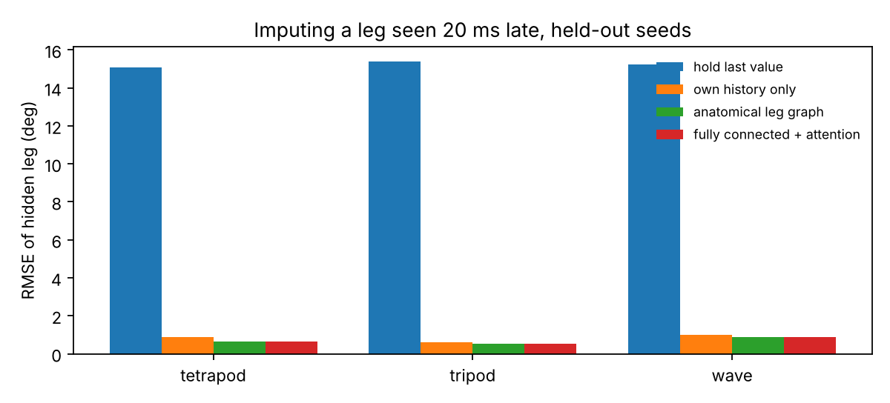
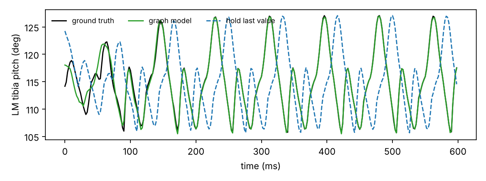
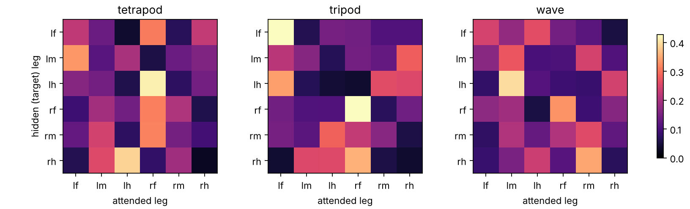
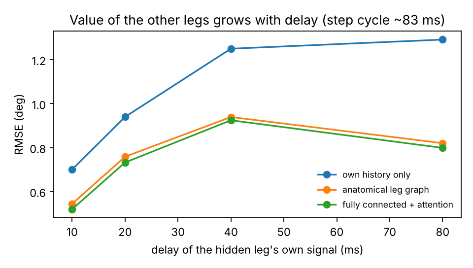

# leg-graph: inter-leg coordination in NeuroMechFly with graph neural networks

A small exploratory project. **Project page with interactive figures: https://zaineb-ibork.github.io/leg-graph/** I simulate walking in [NeuroMechFly](https://github.com/NeLy-EPFL/flygym) (FlyGym 2.x) and ask a graph question about it:

> If one leg is only observed with a delay, how well can its current posture be recovered from the other five legs, and which legs carry that information?

The six legs form a graph: ipsilateral neighbours and contralateral pairs. A graph network passing messages along this graph should outperform a model that only extrapolates the leg's own past, to the extent that leg movements are coordinated. The attention weights then hint at which legs inform which.

It is a first step toward the question that interests me most: how structure in a network, whether a body plan or a connectome, shapes the motor patterns it produces.

## Pipeline

| Step | Script | What it does |
|---|---|---|
| 1 | `simulate.py` | Runs NeuroMechFly on flat ground with a CPG controller (FlyGym tutorial controller) for the tripod, tetrapod and wave gaits, 6 seeds each, 3 s per episode, and randomized CPG coupling strength. Records the 42 actuated leg joint angles (7 per leg), ground contact forces and thorax position at 500 Hz. |
| 2 | `legraph.py` | Builds the dataset and the models. For a target leg *k* at time *t*, the other legs provide their last 20 ms of state, while leg *k* provides only a window that ends *d* ms earlier. The target is leg *k*'s 7 joint angles at *t*. The model is a 2-layer graph attention network over the 6 legs, with three adjacency choices: self only (own history), anatomical leg graph, or fully connected. |
| 3 | `train.py` | Runs E1 (generalization to held-out seeds), E2 (generalization to an unseen gait) and E3 (attention maps). |
| 4 | `delay_sweep.py` | Runs E4: how the value of the other legs changes with the delay *d*. |

```bash
pip install -r requirements.txt
python simulate.py --out data --duration 3.0 --seeds 0 1 2 3 4 5   # ~4 min on CPU
python train.py --data data --out results                          # ~7 min on CPU
python delay_sweep.py --data data --out results
```

## Results

### E1: held-out seeds (train on seeds 0 to 3, test on seeds 4 and 5)

RMSE of the hidden leg's joint angles, in degrees. The target leg is seen 20 ms late, which is about a quarter of the ~83 ms step cycle.

| Model | tripod | tetrapod | wave |
|---|---|---|---|
| hold last value | 15.4 | 15.1 | 15.3 |
| own history only (no message passing) | 0.61 | 0.89 | 1.01 |
| anatomical leg graph | 0.54 | 0.64 | 0.89 |
| fully connected + attention | **0.53** | **0.63** | **0.89** |

Information from the other legs reduces the error by 12 to 29 %. The gain is largest for the tetrapod gait. The anatomical graph, with only 7 edges, performs almost as well as the fully connected one.




### E2: unseen gait (train on tripod and tetrapod, test on wave)

| Model | RMSE (deg) |
|---|---|
| hold last value | 15.3 |
| own history only | **3.42** |
| anatomical leg graph | 4.78 |
| fully connected + attention | 4.28 |

This is a useful negative result. The graph models learn gait-specific phase relations between legs, and these relations hurt when the coordination pattern changes. A model that knows only the leg's own dynamics transfers better. Recovering coordination that generalizes across gaits probably requires inductive biases closer to the underlying controller, such as coupled oscillators or rule-based inter-leg influences, rather than a purely data-driven graph.

### E3: which legs does the model attend to?



Each row shows the last-layer attention of a hidden leg over all legs, averaged over test samples. The patterns differ clearly between gaits. These are correlational read-outs of a trained model, not evidence of causal coupling.

### E4: value of inter-leg information versus delay

Overall test RMSE in degrees, across all gaits. These runs use 8 training epochs, so the 20 ms values differ slightly from E1.

| Delay of own signal | own history only | anatomical graph | fully connected | gain from other legs |
|---|---|---|---|---|
| 10 ms | 0.70 | 0.54 | **0.52** | 26 % |
| 20 ms | 0.94 | 0.76 | **0.73** | 22 % |
| 40 ms | 1.25 | 0.94 | **0.92** | 26 % |
| 80 ms (~ one step cycle) | 1.29 | 0.82 | **0.80** | 38 % |



When the leg's own information is stale, the other legs matter most. Close to one full step cycle, the gain from inter-leg information reaches 38 %.

## Limitations and next steps

- **The coordination is imposed by the controller.** The gaits come from a CPG controller with preprogrammed single-leg steps, so the models recover what the controller encodes. This is a sanity check of the method, not a finding about flies. In this simulation, the tetrapod and wave gaits also make the fly turn rather than walk straight.
- **Natural next steps:**
  - use the rule-based and hybrid controllers, and rough terrain, where coordination emerges from local rules and sensory feedback;
  - apply the same imputation test to real 3D kinematics from tracked flies;
  - replace the 6-node leg graph with a connectome-constrained network, where the structure is given by the wiring diagram, and test whether it predicts the same inter-leg dependencies.

## Author

Zaineb Ibork, JSPS postdoctoral fellow, National Institute of Informatics (NII), Tokyo. My research is on graph neural networks and 3D vision. This repository is a self-directed exploration of FlyGym / NeuroMechFly.
